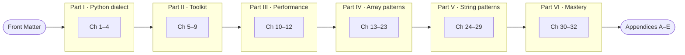

  
  
  
  

**A book that takes you from "knows basic Python" to mastery of arrays and strings 
for LeetCode-style problems and coding interviews.**

## ✨ What's inside

| | |
|---|---|
| 🐍 **The LeetCode dialect of Python** | `class Solution`, `-> None` in-place contracts, type hints old and new, the semantics that silently break answers |
| 🧰 **The complete toolkit** | Every `str` and `list` method, the built-ins and stdlib that matter, and a tier map of what you must be able to **hand-write** |
| ⏱️ **Honest performance** | Complexity with a reason for every claim, and timings measured on real hardware instead of folklore |
| 🧩 **17 pattern chapters** | Each pattern goes brute force → optimal, with templates, invariants, dry runs and practice sets |
| 🎯 **Mastery** | Pattern recognition from the problem statement, mixed problem sets, mock interviews, and the 25 most common bugs |

Every chapter is plain Markdown and renders directly on GitHub. Start with the
**[Front Matter](src/00-front-matter.md)**: how the book is organized, the practice
method, and the re-solve schedule.

## 🗺️ Learning roadmap

