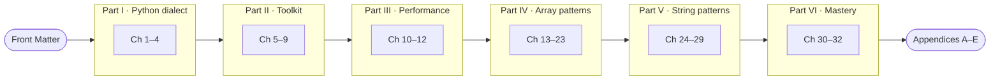

  
  
  
  

**A book that takes you from "knows basic Python" to mastery of arrays and strings 
for LeetCode-style problems and coding interviews.**

## ✨ What's inside

| | |
|---|---|
| 🐍 **The LeetCode dialect of Python** | `class Solution`, `-> None` in-place contracts, type hints old and new, the semantics that silently break answers |
| 🧰 **The complete toolkit** | Every `str` and `list` method, the built-ins and stdlib that matter, and a tier map of what you must be able to **hand-write** |
| ⏱️ **Honest performance** | Complexity with a reason for every claim, and timings measured on real hardware instead of folklore |
| 🧩 **17 pattern chapters** | Each pattern goes brute force → optimal, with templates, invariants, dry runs and practice sets |
| 🎯 **Mastery** | Pattern recognition from the problem statement, mixed problem sets, mock interviews, and the 25 most common bugs |

Every chapter is plain Markdown and renders directly on GitHub. Start with the
**[Front Matter](src/00-front-matter.md)**: how the book is organized, the practice
method, and the re-solve schedule.

## 🗺️ Learning roadmap

## 📚 Table of contents

### Part I · The LeetCode Python Dialect

| # | Chapter | You'll learn |
|---|---|---|
| 1 | [Anatomy of a LeetCode Solution](src/part1/ch01-anatomy-of-a-leetcode-solution.md) | How the judge calls your code; why `nums = nums[::-1]` fails |
| 2 | [Type Hints, Completely](src/part1/ch02-type-hints-completely.md) | `List[int]` vs `list[int]`, `Optional` vs `\| None`, and what each Python version allows |
| 3 | [Core Python Semantics](src/part1/ch03-core-python-semantics.md) | Aliasing, `//` with negatives, no overflow, the self-referencing swap trap |
| 4 | [Comprehensions & Generators](src/part1/ch04-comprehensions-and-generators.md) | Grids without aliasing, lazy evaluation, measured speed |

### Part II · The Complete Toolkit

| # | Chapter | You'll learn |
|---|---|---|
| 5 | [Every `str` Method](src/part2/ch05-every-str-method.md) | All 47 methods, `split()` vs `split(" ")`, why `+=` can go quadratic |
| 6 | [Every `list` Operation](src/part2/ch06-every-list-operation.md) | Dynamic arrays, `pop(0)` vs `pop()`, stable multi-key sorting |
| 7 | [Built-in Functions for DSA](src/part2/ch07-built-in-functions-for-dsa.md) | Iterators vs lists, banker's rounding, `int()` pitfalls |
| 8 | [Standard Library for DSA](src/part2/ch08-standard-library-for-dsa.md) | `Counter`, `deque`, `heapq`, `bisect`, `itertools`, `functools`, `math` |
| 9 | [Built-in vs Hand-Written](src/part2/ch09-built-in-vs-hand-written.md) | The tier map, and the statement phrases that take built-ins away |

### Part III · Complexity & Python Performance

| # | Chapter | You'll learn |
|---|---|---|
| 10 | [Complexity Analysis, Properly](src/part3/ch10-complexity-analysis.md) | Constraints → target complexity, from a measured Python budget |
| 11 | [Python Performance Reality](src/part3/ch11-python-performance-reality.md) | Why CPython is slow, and "push the loop into C" |
| 12 | [Operation Complexity Cheat Sheet](src/part3/ch12-operation-complexity-cheat-sheet.md) | Every common operation's cost, with the reason |
