  
  
  
  

**A book that takes you from "knows basic Python" to mastery of arrays and strings 
for LeetCode-style problems and coding interviews.**

## ✨ What's inside

| | |
|---|---|
| 🐍 **The LeetCode dialect of Python** | `class Solution`, `-> None` in-place contracts, type hints old and new, the semantics that silently break answers |
| 🧰 **The complete toolkit** | Every `str` and `list` method, the built-ins and stdlib that matter, and a tier map of what you must be able to **hand-write** |
| ⏱️ **Honest performance** | Complexity with a reason for every claim, and timings measured on real hardware instead of folklore |
| 🧩 **17 pattern chapters** | Each pattern goes brute force → optimal, with templates, invariants, dry runs and practice sets |
| 🎯 **Mastery** | Pattern recognition from the problem statement, mixed problem sets, mock interviews, and the 25 most common bugs |

Every chapter is plain Markdown and renders directly on GitHub. Start with the
**[Front Matter](src/00-front-matter.md)**: how the book is organized, the practice
method, and the re-solve schedule.

## 🗺️ Learning roadmap

## 📚 Table of contents

### Part I · The LeetCode Python Dialect

| # | Chapter | You'll learn |
|---|---|---|
| 1 | [Anatomy of a LeetCode Solution](src/part1/ch01-anatomy-of-a-leetcode-solution.md) | How the judge calls your code; why `nums = nums[::-1]` fails |
| 2 | [Type Hints, Completely](src/part1/ch02-type-hints-completely.md) | `List[int]` vs `list[int]`, `Optional` vs `\| None`, and what each Python version allows |
| 3 | [Core Python Semantics](src/part1/ch03-core-python-semantics.md) | Aliasing, `//` with negatives, no overflow, the self-referencing swap trap |
| 4 | [Comprehensions & Generators](src/part1/ch04-comprehensions-and-generators.md) | Grids without aliasing, lazy evaluation, measured speed |

### Part II · The Complete Toolkit

| # | Chapter | You'll learn |
|---|---|---|
| 5 | [Every `str` Method](src/part2/ch05-every-str-method.md) | All 47 methods, `split()` vs `split(" ")`, why `+=` can go quadratic |
| 6 | [Every `list` Operation](src/part2/ch06-every-list-operation.md) | Dynamic arrays, `pop(0)` vs `pop()`, stable multi-key sorting |
| 7 | [Built-in Functions for DSA](src/part2/ch07-built-in-functions-for-dsa.md) | Iterators vs lists, banker's rounding, `int()` pitfalls |
| 8 | [Standard Library for DSA](src/part2/ch08-standard-library-for-dsa.md) | `Counter`, `deque`, `heapq`, `bisect`, `itertools`, `functools`, `math` |
| 9 | [Built-in vs Hand-Written](src/part2/ch09-built-in-vs-hand-written.md) | The tier map, and the statement phrases that take built-ins away |

### Part III · Complexity & Python Performance

| # | Chapter | You'll learn |
|---|---|---|
| 10 | [Complexity Analysis, Properly](src/part3/ch10-complexity-analysis.md) | Constraints → target complexity, from a measured Python budget |
| 11 | [Python Performance Reality](src/part3/ch11-python-performance-reality.md) | Why CPython is slow, and "push the loop into C" |
| 12 | [Operation Complexity Cheat Sheet](src/part3/ch12-operation-complexity-cheat-sheet.md) | Every common operation's cost, with the reason |

### Part IV · Array Patterns

| # | Chapter | Core idea |
|---|---|---|
| 13 | [Array Fundamentals & In-Place](src/part4/ch13-array-fundamentals-and-in-place.md) | Write pointers, fill from the back, rotate by reversal |
| 14 | [Hashing & Frequency Counting](src/part4/ch14-hashing-and-frequency-counting.md) | Complements, signatures, buckets |
| 15 | [Prefix Sums & Difference Arrays](src/part4/ch15-prefix-sums-and-difference-arrays.md) | `sum(a[i:j]) = p[j] − p[i]`, prefix + hash map |
| 16 | [Two Pointers](src/part4/ch16-two-pointers.md) | Discard one candidate per step |
| 17 | [Sliding Window](src/part4/ch17-sliding-window.md) | Shrink while invalid; exactly k = at most k − at most (k−1) |
| 18 | [Sorting as a Tool](src/part4/ch18-sorting-as-a-tool.md) | Merge/quick/counting sort by hand, intervals, quickselect |
| 19 | [Binary Search](src/part4/ch19-binary-search.md) | One invariant; binary search on the answer |
| 20 | [Kadane & Subarray Optimization](src/part4/ch20-kadane-and-subarray-optimization.md) | Best sum ending here; a gentle start on DP |
| 21 | [Monotonic Stack & Deque](src/part4/ch21-monotonic-stack-and-deque.md) | Next greater, histograms, window maximum |
| 22 | [Matrices](src/part4/ch22-matrices.md) | Rotate, spiral, in-grid markers |
| 23 | [Index Tricks & Voting](src/part4/ch23-index-tricks-and-voting.md) | Cyclic sort, Floyd, Boyer–Moore, XOR |

### Part V · String Patterns

| # | Chapter | Core idea |
|---|---|---|
| 24 | [String Fundamentals](src/part5/ch24-string-fundamentals-for-dsa.md) | `ord` arithmetic, tokenizing, building strings |
| 25 | [Hashing on Strings](src/part5/ch25-hashing-on-strings.md) | Signatures, sliding counts, rolling hashes |
| 26 | [Palindromes](src/part5/ch26-palindromes-and-two-pointers.md) | Two pointers inward, expand around centers, Manacher |
| 27 | [Sliding Window on Strings](src/part5/ch27-sliding-window-on-strings.md) | The need/have technique |
| 28 | [Parsing, Simulation & Stacks](src/part5/ch28-parsing-simulation-and-stacks.md) | atoi, decoding, calculators, digit arithmetic |
| 29 | [String Matching Algorithms](src/part5/ch29-string-matching-algorithms.md) | Rabin–Karp, KMP, Z-function |

### Part VI · Mastery

| # | Chapter | What it gives you |
|---|---|---|
| 30 | [Pattern Recognition](src/part6/ch30-pattern-recognition.md) | 51 signal phrases, a decision tree, an interview attack method |
| 31 | [Mixed Problem Sets](src/part6/ch31-mixed-problem-sets.md) | 5 unlabeled sets of 8 and two timed mock interviews |
| 32 | [Bugs, Edge Cases & Debugging](src/part6/ch32-bugs-edge-cases-and-debugging.md) | The 25 most common bugs, stress testing, shrinking |

### Appendices

| | Appendix | |
|---|---|---|
| A | [Cheat Sheets](src/appendix/a-cheat-sheets.md) | Every chapter's cheat sheet, ready to print |
| B | [Master Problem List](src/appendix/b-master-problem-list.md) | All 119 problems with pattern, chapter and link |
| C | [Re-solve Tracker](src/appendix/c-resolve-tracker.md) | Day 1 / 3 / 7 / 21 columns for every problem |
| D | [Hints and Solutions](src/appendix/d-hints-and-solutions.md) | Exercise answers and practice hints, kept away from the problems |
| E | [Glossary](src/appendix/e-glossary.md) | 48 terms with the chapter that explains each |

## 🔁 The practice method

Reading doesn't create mastery; solving does. For every problem:

1. **Struggle for 25–40 minutes** before taking a hint, and take a hint before reading a solution.
2. **Read the solution, close it, and re-code it from a blank file.**
3. **Log the clue** that revealed the pattern in your pattern notebook.
4. **Re-solve on a schedule**, and restart at day 1 if a re-solve fails:

## 🧩 Patterns you'll master

## 📖 How this book is written

- **Every complexity claim comes with a reason**: time and auxiliary space, stated separately.
- **Every speed claim was measured** (CPython 3.13.2), or is explicitly labeled as general knowledge.
- **Every version-specific feature is tagged** with the Python version that introduced it.
- **Every tool carries a tier**: **[USE-FREELY]**, **[KNOW-HOW]** or **[HAND-WRITE]**.
- **No problem statements are copied.** Each problem is summarized in the book's own words and linked to LeetCode.

> **Note:** the chapters mention supporting files under `code/` and `bench/` (tested
> solutions and benchmarks). Those aren't part of this repository; the chapters include
> the full solution code inline.

